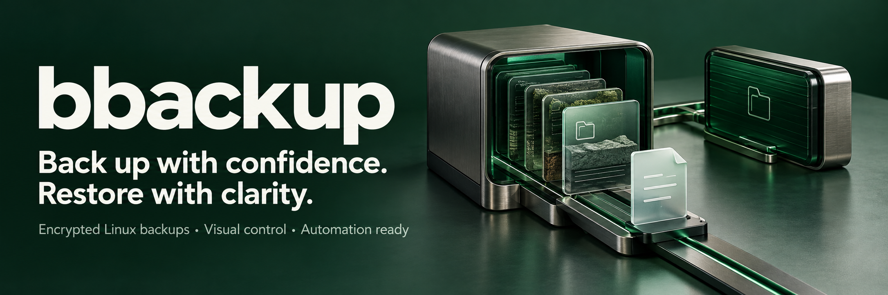

# bbackup

**Back up with confidence. Restore with clarity.**

bbackup is an encrypted, restic-based backup tool for Linux system administrators, homelab and self-hosted operators, and small infrastructure teams. It brings local file backups, selected database workflows, verified file restores, and observable scheduled jobs into one operator workflow.

[](https://www.python.org/downloads/) [](LICENSE) [](https://github.com/CruxExperts/BestBackup/releases/latest)



[Get started](QUICKSTART.md) · [Install](INSTALL.md) · [Qualification evidence](docs/development/version-2.md) · [Automation and agents](docs/AGENT_INTEGRATION.md) · [All documentation](docs/README.md)

## A practical backup and restore workflow

Use bbackup when you want to know what a job captured, whether each repository copy succeeded, and whether files can be restored into a clean destination.

- **Set up once.** The terminal dashboard guides source, encrypted storage, schedule, and enrollment. Portable policy records job intent; private host bindings hold paths and credential-file references.
- **Capture and copy.** Create encrypted restic snapshots of file trees and optionally copy a successful snapshot to a separately configured repository. Results show the outcome for each destination.
- **Restore and verify.** Restore files into a new directory and ask restic to verify them. This checks file data, not application startup or full-machine recovery.
- **Schedule and observe.** Run named jobs from the dashboard, the JSON CLI, or generated user-level systemd timers. Progress, results, repository locks, and interrupted-operation status are visible to operators and automation.
- **Recover deliberately.** An interrupted mutation can have an uncertain result. Inspect the destination and reconcile that operation explicitly; bbackup does not automatically replay it.


## v2.0.4 tested scope

The qualified scope covers local file capture and restore; live capture and restore for PostgreSQL 17.11, MySQL 8.4.12, and MariaDB 11.8.9; headless dashboard happy paths; and AMD64 Ubuntu 24.04/26.04 packages. A separate real-guest user-timer reboot drill covers only the components and conditions recorded in the [qualification evidence](docs/development/version-2.md#development-candidate-rebootable-systemd-qualification).

B2/AWS, native Docker, ARM64 backup/restore, cross-application-version upgrades and rollback, root-owned systemd package templates, and cloud or off-host protection remain unqualified. ARM64 packages may be built, but build or package-install smoke checks alone do not qualify backup/restore. Keep an independently retrievable copy of repository passwords; a second repository on the same host does not protect against host loss. See [installation](INSTALL.md) for prerequisites and release install instructions.

Recent live B2 evidence covers a small interrupted maintenance run
whose prune outcome remained uncertain, and a separate lifecycle-overlap guard
that made central retention refuse the configured bucket. Neither test proves
prune completion, elapsed lifecycle expiry, physical reclamation, or provider
protection. These workflows ship in v2.0.4 as experimental and remain
unqualified. See the [maintenance interruption record](docs/development/version-2.md#live-b2-central-maintenance-interruption-trial)
and [lifecycle guard evidence](docs/cloud-storage.md#b2-lifecycle-overlap-guard-experimental).
Requests #23–#26 remain open; the qualified core scope is unchanged from v2.0.3.

## Start with the guided workflow

Experimental restricted cloud credentials, central recovery and retention,
bounded remote-primary capture, and reviewed Linux coverage ship in v2.0.4 and
are [documented with their limits](docs/development/version-2.md#experimental-cloud-and-machine-recovery-features).
The reviewed Linux coverage work includes an experimental manual PostgreSQL
path. These features do not expand the tested stable scope.

For packaged releases, start with the [latest release downloads](https://github.com/CruxExperts/BestBackup/releases/latest) and [installation guide](INSTALL.md).

From a development checkout with Python 3.12+, uv, and restic installed:

```bash
git clone https://github.com/CruxExperts/BestBackup.git
cd BestBackup
uv sync --locked
uv run bbackup production tui
```

Choose a source folder, encrypted storage, and a schedule. Review and enroll once. The dashboard then guides you through initializing storage, running the first backup, and restoring into a new folder. Advanced settings and the command line remain available. The [quick start](QUICKSTART.md) covers migration, password custody, replica setup, and deliberate schedule activation.

## Choose a guide

- [Install](INSTALL.md): prerequisites, release packages, and development setup.
- [Quick start](QUICKSTART.md): first backup, schema-2 migration, replica, verified restore, and user-level scheduling.
- [Automation and agent integration](docs/AGENT_INTEGRATION.md): schemas, progress, results, and uncertain-operation reconciliation.
- [Production command reference](docs/production-cli.md): generated command and input-schema reference.
- [Cloud storage](docs/cloud-storage.md): implemented provider paths and their qualification limits.
- [Encryption](docs/encryption.md): password custody and legacy encryption compatibility.
- [Architecture](docs/architecture.md): shared operations, durable state, and safety boundaries.
- [Legacy management](docs/management.md): retained 1.x Docker/YAML commands and compatibility guidance.
- [Support](SUPPORT.md) · [Security](SECURITY.md) · [Contributing](CONTRIBUTING.md)

## License

Code is available under the [MIT License](LICENSE). Original documentation artwork carries separate [asset terms and provenance](docs/assets/README.md).

<!-- project-footer:start -->

<br><br>

<p align="center">
Slavic Kozyuk<br>
&copy; 2026 <a href="https://www.cruxexperts.com/">Crux Experts LLC</a> &mdash; <a href="https://github.com/CruxExperts/BestBackup/blob/main/LICENSE">MIT License</a>
</p>

<!-- project-footer:end -->
