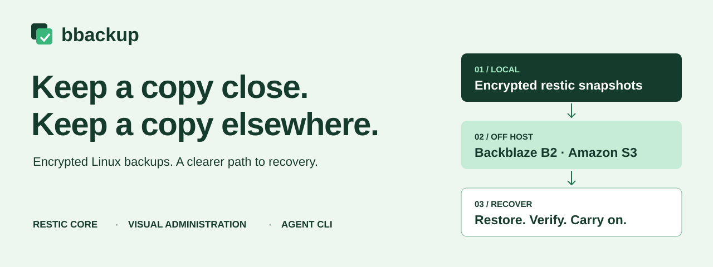

# bbackup

**Local-first, encrypted backup and restore for Linux servers.** Capture to a nearby repository, replicate selected snapshots to independent storage, and restore into a new directory.

[](https://www.python.org/downloads/) [](LICENSE) [](CHANGELOG.md)

[Quick start](QUICKSTART.md) · [Install](INSTALL.md) · [Cloud storage](docs/cloud-storage.md) · [Agent CLI](docs/AGENT_INTEGRATION.md) · [All documentation](docs/README.md)



> [!WARNING]
> Stable v2.0.0 covers only the tested paths below. Keep an independent recovery path and verify restores before using real data.

## Keep recovery close and independent

- **Recover quickly from local storage.** Restore from a nearby encrypted repository without waiting for a cloud download.
- **Keep an independent replica.** Copy successful snapshots to another repository. Local-to-local replication is tested; B2/AWS remain unqualified.
- **Protect Linux workloads.** Capture file trees and selected database sources through named jobs.
- **Choose mouse or automation.** Use the Textual dashboard or strict, schema-discoverable JSON commands.

## Production support scope

The v2.0.0 stable support claim is limited to local file capture and restore,
live PostgreSQL 17.11, MySQL 8.4.12, and MariaDB 11.8.9 capture/restore,
headless dashboard happy paths, and AMD64 Ubuntu 24.04/26.04 packages. B2/AWS,
native Docker, ARM64 package functionality, cross-application-version upgrades
or rollback, systemd boot/reboot, and cloud/off-host retention remain
unqualified. The release workflow may publish ARM64 package artifacts, but
artifact availability does not qualify ARM64 backup/restore.
See [v2 release evidence](docs/development/version-2.md) for exact tests and limits.

## Install v2.0.0

Install stable v2 from its pinned source tag:

```bash
uv tool install --force 'git+https://github.com/CruxExperts/best-backup.git@v2.0.0'
```

For the retained 1.x command line, install the `v1.8.6` release tag:

```bash
uv tool install --force 'git+https://github.com/CruxExperts/best-backup.git@v1.8.6'
```

See [INSTALL.md](INSTALL.md) for prerequisites and development setup. Version 2 requires Python 3.12+ and `restic`; Docker, `rsync`, and `tar` are only needed by the retained 1.x Docker/filesystem workflow. Database capture and restore also require the matching native database clients.

## First v2 capture

Create strict portable policy and private host bindings as described in the [quick start](QUICKSTART.md), then run:

```bash
bbackup production --config config.json --bindings bindings.json doctor
bbackup production --config config.json --bindings bindings.json jobs run --name daily
```

`jobs run` captures locally and copies the successful snapshot to each configured replica. Keep the returned full snapshot IDs. The quick start shows how to verify a repository and restore a selected ID into a new directory.

## Cloud destinations

B2 through its S3 API and Amazon S3 can be configured as repositories, but neither provider has a live capture/check/restore qualification for v2.0.0. Native B2 inspection is read-only and does not prove backup transfer or retention. Do not rely on these paths for production backups; see the [cloud storage guide](docs/cloud-storage.md).

## Choose a guide

- [Quick start](QUICKSTART.md): v2 configuration, password files, local capture, replicas, and restore.
- [Installation](INSTALL.md): pinned source installs, legacy release, and development checkout.
- [Agent integration](docs/AGENT_INTEGRATION.md): strict schemas, JSON envelopes, pagination, and reconciliation.
- [Cloud storage](docs/cloud-storage.md): B2/S3 repository setup and provider qualification limits.
- [Legacy management](docs/management.md): retained `bbman` and 1.x commands.
- [Encryption](docs/encryption.md): restic password custody and legacy file-encryption modes.
- [Architecture](docs/architecture.md): v2 operation service, storage model, tested scope, and retained implementation.
- [Support](SUPPORT.md) · [Security](SECURITY.md) · [Contributing](CONTRIBUTING.md)

## License

[MIT](LICENSE)

<!-- project-footer:start -->

<br><br>

<p align="center">
Slavic Kozyuk<br>
&copy; 2026 <a href="https://www.cruxexperts.com/">Crux Experts LLC</a> &mdash; <a href="https://github.com/CruxExperts/best-backup/blob/main/LICENSE">MIT License</a>
</p>

<!-- project-footer:end -->
