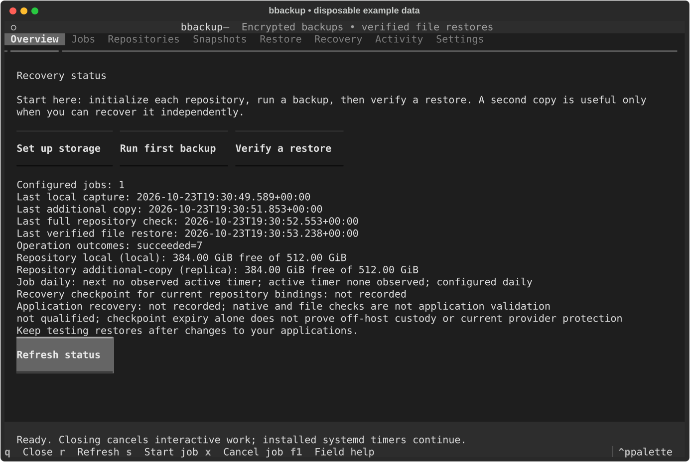

# Version 2 development

> Stable v2.0.0 production qualification is limited to the tested scope
> recorded below. Other implemented paths remain unqualified or deferred.
> See the 2026-10-17 qualification record for exact evidence and limits.

## Direction and delivery order

The selected stable v2.0.0 release scope is local/file capture and restore,
live capture-restore drills for PostgreSQL 17.11, MySQL 8.4.12, and MariaDB
11.8.9, headless dashboard happy paths, and AMD64 Ubuntu 24.04/26.04 packages.
The CLI and Textual dashboard share one operations service. Existing 1.x commands
remain available. This is a bounded tested-scope release, not qualification of
every implemented feature.

Earlier qualification assessed the wider implemented feature scope, including
B2/AWS, native Docker, ARM64 outputs, ordinary cross-application upgrades and
rollback, and systemd boot/reboot behavior. Those paths did not have the
required acceptance evidence and are not included in the selected stable
support boundary.

Delivery proceeds through core/configuration, capture/restore, cloud protection
and independent escrow, CLI/TUI, then packages/documentation/release qualification.
An implemented capability does not establish completion of its entire delivery slice.

## Implemented capabilities

- Strict version-2 JSON configuration rejects duplicate keys, unknown fields,
  unsupported source types, and inconsistent repository references. Private host
  bindings and password files are separate from portable policy.
- Typed operation plans, bounded process output, timeouts, process-group
  cancellation, sanitized SQLite lifecycle records, and repository locks provide
  a shared execution boundary. Interrupted mutations remain uncertain; they are
  never automatically replayed. Receipts commit before operations finish.
- File trees go directly to restic. SQLite databases use the backup API and a
  private temporary export; uncommitted writes are excluded. PostgreSQL streams
  custom-format native exports; MySQL/MariaDB require an explicit read-lock policy.
  Native adapters have also passed bounded live concurrent-write recovery drills
  described below. Live file trees remain best-effort captures, not atomic
  filesystem snapshots.

### Native Docker capture and recovery

This implemented path is not production-qualified and is outside the selected
stable v2.0.0 release scope. Docker capture is opt-in and requires a local Docker Unix socket in the private
host bindings. The portable source policy names one container and requires an
explicit stop-and-restart window:

```json
{"name":"application","kind":"docker","container":"web","connection":"local_docker","stop_policy":"stop-restart"}
```

```json
{"docker_bindings":{"local_docker":{"kind":"docker","socket":"/var/run/docker.sock"}}}
```

The capture records the pinned image ID, container configuration, environment,
labels, restart policy, daemon-provided `MaskedPaths` and `ReadonlyPaths`, and
persistent local bind/volume paths in private metadata inside the encrypted
restic snapshot. Mask and read-only paths are validated as absolute container
paths and preserved from inspection rather than hard-coded. Environment values
and labels may contain secrets. Only selected containers are stopped; already
stopped containers remain stopped. Capture is refused if a running, unselected
container shares any persistent source path. With a rootful daemon, the bbackup
process also needs access to selected source paths and every path in the running
container sharing inventory; an inaccessible unrelated mount source blocks
preflight before any container is stopped. Selected running containers are
restarted before the capture receipt or successful ledger outcome is committed.
If restart is uncertain, no successful receipt is created and a private durable
intention remains in service state.

The unqualified native Docker path refuses deployment features and container state it cannot restore
faithfully. It ignores only added writable-layer entries exactly at persistent
mount destinations, whose mountpoint directories are recreated by the restored
mounts; siblings, descendants, modified/deleted entries, and other writable-layer
changes remain unsupported. It also rejects remote Docker endpoints, non-local
volume drivers or options, custom networks, published ports, privileged access,
added capabilities/devices, non-default resource limits, and unknown host
settings. Explicit bind and local-volume entries in `Binds` or typed
`HostConfig.Mounts` are accepted only when they match Docker's inspected mounts
and use supported default options.
Restore requires the exact captured image ID to already exist locally; it
never pulls an image. Restored application data is staged under a new target
directory, and a new container name is required. Local-volume data is restored
as a bind mount under that directory, retaining the original container target
and read-only mode. Restic verifies restored files; the operation also waits
for the new container to run and, when the image defines a health check, become
healthy. These checks do not establish business-level application-data validity
or production qualification.

For example, restoring source `application` into a new container and directory:

```sh
bbackup production docker restore --repository local --snapshot FULL_SNAPSHOT_ID \
  --source application --connection local_docker --target /srv/restore/web \
  --container web-recovered --trusted-archive
```

The target directory must not already exist. For an uncertain create or start,
inspect the exact target first, then record the reviewed ledger outcome without
replaying the operation:

```sh
bbackup production docker reconcile --connection local_docker --container web-recovered \
  --operation-id OPERATION_ID --outcome succeeded --docker-reviewed
```

After reviewing the exact daemon and container, use
`bbackup production docker recover --connection local_docker --reviewed` to
resolve durable capture restart intentions. Recovery acts only on the exact
container ID and daemon identity recorded by capture. A pre-stop intention
does not start a container that is now stopped. `docker reconcile` only records
a reviewed ledger outcome; it never starts, stops, removes, or retries Docker
resources. Inspect and resolve any retained target or intention before another
capture or restore.
- Local capture records complete successful snapshot IDs. Copies use independent
  passwords and matching chunking parameters, then verify the destination identity.
  A failed or incomplete capture is not eligible for replication.
- Restore requires a new directory outside source paths, repositories, credentials,
  and runtime state, and asks restic to verify restored files. This does not prove
  application startup or database recovery.
- The v2 CLI emits a version-2 JSON envelope, accepts strict JSON or flags,
  rejects duplicate inputs, and exposes bounded pagination. The Textual dashboard
  supports mouse/keyboard job selection, search, table sorting, and systemd start
  and cancel requests. Its Restore tab accepts a repository, full snapshot ID,
  and new destination directory, and performs the same verified file restore
  as the CLI without blocking navigation. Selecting a snapshot fills its identity.
  Cancellation retains partial files; closing the dashboard cancels and waits
  for its interactive restore while detaching from installed systemd jobs.
- Generated systemd timers use daily scheduling and persistent missed-run handling.
  Rendering does not install or enable units.



## Trying version 2 locally

Use a disposable local directory and private password files. Keep state and
repositories outside every source tree. The following paths are examples, not
installed defaults.

Portable configuration (`config.json`):

```json
{
  "schema_version": 2,
  "repositories": [
    {"name": "local", "role": "local"},
    {"name": "replica", "role": "replica"}
  ],
  "sources": [
    {"name": "documents", "kind": "files", "paths": ["/srv/documents"]}
  ],
  "jobs": [
    {"name": "daily", "repository": "local", "sources": ["documents"], "replicas": ["replica"]}
  ]
}
```

Private host bindings (`bindings.json`, mode 0600):

```json
{
  "schema_version": 2,
  "state_dir": "/var/lib/bbackup",
  "repositories": {
    "local": {"repository": "/srv/backup-local", "password_file": "/etc/bbackup/local.password"},
    "replica": {"repository": "/srv/backup-replica", "password_file": "/etc/bbackup/replica.password"}
  }
}
```

Create password files yourself with independent passwords and mode 0600. They
must be available without interactive prompts. State must have mode 0700.
An S3 binding can use restic's `s3:https://ENDPOINT/BUCKET/PREFIX` syntax;
provider credentials belong in the supervised process environment, never in JSON
policy or repository URLs.

```bash
bbackup production --config config.json --bindings bindings.json doctor
bbackup production --config config.json --bindings bindings.json repositories init --name local
bbackup production --config config.json --bindings bindings.json repositories init --name replica --source local
bbackup production --config config.json --bindings bindings.json jobs run --name daily
bbackup production --config config.json --bindings bindings.json repositories check --name replica
bbackup production --config config.json --bindings bindings.json snapshots list --limit 100
bbackup production --config config.json --bindings bindings.json tui
```

Use the exact destination snapshot ID from the copy result for restore:

```bash
bbackup production --config config.json --bindings bindings.json restore \
  --repository replica --snapshot FULL_DESTINATION_SNAPSHOT_ID --target /srv/new-restore
```

Every registered operation provides `--schema`. The generated
[command reference](../production-cli.md) and packaged
`bbackup/data/production-schemas.json` come from `bbackup/cli_metadata.py` through
`scripts/generate_cli_skills.py`. Exit 2 indicates invalid input, exit 3 an
operational failure. Production command syntax errors use the same sanitized envelope. `runs stream` explicitly emits bounded JSON-lines lifecycle events. Raw subprocess errors
and commands are not included in the public envelope.

## Setup and configuration editing

The dashboard opens first-run setup when both explicitly selected files are new.
Its two JSON editors accept the same portable policy and private host-binding
schemas shown above. Existing files are never overwritten by setup. A partial
pair is an error that needs inspection, not permission to replace the other file.
Setup validates matching repository and database bindings, creates private files,
and opens the configured dashboard. It does not initialize repositories, capture
files, or install or enable services.

```bash
bbackup production --config new-config.json --bindings new-bindings.json tui
bbackup production --config new-config.json --bindings new-bindings.json setup \
  --configuration-file reviewed-config.json --bindings-file reviewed-bindings.json
```

These are alternative setup methods; do not run both against the same new files.
Keep credential values in separate private files or the supervised environment.
Host-binding JSON contains references, not passwords or access tokens.

The Settings tab edits the complete portable JSON policy without exposing host
bindings. Reload before editing. Save validates the new policy against current
bindings and refuses a stale revision. The previous exact bytes are kept in a
dated, mode-0600 gzip file under the private state's `configuration-backups/`
directory before replacement. The command-line equivalent is:

```bash
bbackup production --config config.json --bindings bindings.json config show
bbackup production --config config.json --bindings bindings.json config save \
  --document-file reviewed-config.json --revision REVIEWED_SHA256_REVISION
```

Use the `revision` returned by `config show`, not a revision from another edit.
Both interfaces share validation and persistence. Saving changes neither
credentials nor running system services. Regenerate and review installed timer
units after schedule changes. The current dashboard reloads policy after a
successful save; already running jobs retain their original operation plans.
External editors do not participate in the application's advisory write lock;
do not edit the same file concurrently while saving through either interface.

### Shared administration and progress

Jobs, Repositories, Snapshots, and Recovery offer typed operation forms from
the same strict registry used by the command interface. Unknown fields are
rejected; destructive approvals and trust acknowledgements default to false.
Operations run away from the interface thread, support explicit cancellation,
and retain uncertain or partial state rather than retrying automatically.
The Activity tab refreshes sanitized lifecycle events without raw commands,
credentials, or native database output.

Overview and `doctor` read the same durable observations: last successful local
capture, independent/cloud copy, full repository check, verified file restore,
native database/container restore, and recorded outcome counts. Local capacity
comes from the repository filesystem or its nearest existing parent; remote
quota is explicitly unavailable. Next runs are reported only for observed
loaded and active systemd timers, not inferred from configured calendars.
Signed checkpoint metadata is tied to the current repository binding and shows
expired, unexpired, or unknown expiry. Neither an unexpired checkpoint nor a
successful file/native restore proves off-host custody, current provider
protection, or application recovery.

Before an existing receipt database changes schema, the application holds its
SQLite write reservation and takes a consistent backup of the committed old
database. A validated, dated mode-0600 gzip copy is flushed under the private
state directory's `state-backups/` before schema changes begin. Failure to
preserve that backup stops migration. The backup restores receipt metadata,
not repository contents or the whole machine. Stop all writers and retain
the matching application version before an operator restores an older schema.

The default command contract remains exactly one JSON result envelope. Opt in
to numeric newline-delimited progress only when the consumer supports a stream:

```bash
bbackup production --config config.json --bindings bindings.json --progress-json \
  jobs run --name daily
```

The stream ends with the usual result envelope. Progress includes only bounded
numeric counters and percentages; paths, filenames, credentials, and native
dump contents are excluded. Cancellation still requires inspecting uncertain
mutations before a later retry.


## Operational limits

Use one shared state directory for all bbackup writers for a repository. The
local ledger lock cannot coordinate an independently invoked restic process or
another host using a different ledger. Restic provides its own repository locks,
but independent recovery checkpoints additionally need a coordinated quiescent
window across all writers.

The v2 retention workflow has no automatic deletion or pruning schedule. Local retention can
forget explicitly reviewed snapshots using restic's daily selection policy,
grouped by host and filtered by the job tag. Seven local daily recovery points
is the default; this is not a count of the last seven captures. Cloud defaults
of thirty daily, eight weekly, and twelve monthly points remain policy, not a
qualified provider lifecycle or pruning implementation.

```bash
bbackup production --config config.json --bindings bindings.json retention plan --job daily
bbackup production --config config.json --bindings bindings.json retention apply \
  --job daily --plan-token REVIEWED_PLAN_TOKEN --approved
```

Review `target_snapshot_ids` and every protected snapshot before approving the
exact returned token. A plan binds the repository inventory, immutable
capture-time replica requirements, successful copy receipts, policy, and exact
snapshot IDs. Apply recomputes the plan under the local repository lease and
rejects stale approval. Missing legacy evidence, foreign or unrecorded captures,
and incomplete required replication are held rather than guessed safe.
Confirmed deletion removes matching local receipts. Neither command prunes
packs: forgetting snapshots does not reclaim their shared physical data.
Failed or unconfirmed mutations require inspection before reconciliation.

Local capture stops on a minimum-space check or restic failure; it does not
reclaim pending recovery points. The fixed 64 MiB preflight threshold is not a
capacity forecast. Capture may still run out of space, in which case no
successful receipt is written.

Uncertain operations require administrator reconciliation against repository
state and the recorded capture operation tag. Do not clear the ledger or remove
restic locks to make a retry proceed. `runs reconcile` records an explicitly administrator-reviewed outcome without
replaying the command. Review the repository first; the command does not
synthesize missing snapshot receipts or remove repository locks. Failed restore output is retained for inspection; empty targets
from a refused dispatch are removed when possible.

## Native database capture and restore

PostgreSQL sources use `kind: "postgresql"`, a safe `database` name, and a
`connection` reference instead of `paths`. The corresponding private
`database_bindings` entry contains `kind`, an absolute `service_file`, a
`service_name`, and optionally an absolute `password_file`. The service and
password files must be private regular files. Native output must have the
PostgreSQL custom-archive signature before it becomes eligible for backup.

MySQL and MariaDB sources use `kind: "mysql"` or `"mariadb"`, `database`,
`connection`, and explicitly `quiesce: "read-lock"`. Their private binding uses
matching `kind` and an absolute `options_file`. The native MySQL/MariaDB path refuses non-InnoDB
tables and uses a native global read lock for the dump, blocking writes while it
runs. This explicit policy prevents concurrent schema changes from invalidating
the export. It requires the database account's corresponding lock privileges;
it is not a zero-interruption capture mode. MySQL login-path overrides are disabled.

Native database clients must be installed separately on the capture and restore
hosts. New database captures include a versioned manifest inside the snapshot.
PostgreSQL restore uses that snapshot-time manifest, so the original source
configuration and ledger are not required. Select a destination connection from
private host bindings and a new database name:

```bash
bbackup production --config config.json --bindings bindings.json databases restore \
  --repository replica --snapshot FULL_DESTINATION_SNAPSHOT_ID \
  --source DATABASE_SOURCE_NAME --connection RECOVERY_CONNECTION \
  --target-database recovered_app --trusted-archive
```

PostgreSQL restore requires PostgreSQL 15 or newer and libc locale databases. Capture
records the source encoding, collation, and character classification; restore
creates the destination from the pristine `template0` with those exact settings.
The matching locales must be installed on the destination server. ICU and other
locale providers are refused until their version-specific metadata is supported.

The archive must come from a trusted source: database restores execute archived
SQL. The command refuses existing databases, stops on restore errors, and checks
read-only connectivity afterward. It never drops a database, and an interrupted
restore retains the partial destination for inspection. Use `databases reconcile`
only after inspecting that destination. Coordinate all writers through one state
directory and one destination binding; differently named service aliases are not
proof of different servers. Connectivity success does not establish application
startup or application-specific data correctness.

MySQL and MariaDB restoration uses the same snapshot manifest, but requires the
**original database name on a separate, empty recovery server**. Only built-in
schemas may exist there; create neither the target database nor application
accounts before the restore. The administrative connection must support native
DEFINER views, routines, triggers, and events. Do not point this operation at an
existing production server or permit other writers during recovery:

```bash
bbackup production --config config.json --bindings bindings.json databases restore \
  --repository replica --snapshot FULL_DESTINATION_SNAPSHOT_ID \
  --source DATABASE_SOURCE_NAME --connection ISOLATED_RECOVERY_CONNECTION \
  --target-database ORIGINAL_DATABASE_NAME --trusted-archive \
  --isolated-server-confirmed
```

Only supported versioned native exports are accepted; arbitrary or legacy SQL
files are refused. Connection options are pinned privately across all commands,
and unsafe overrides, included configuration files, login paths, reconnects,
and local-file imports are disabled or refused. An ambiguous import retains its
partial state and blocks further MySQL-family restores in that state directory.
Inspect the entire recovery server before reconciliation; changing the binding
name or target is not permission to retry. Database restore neither drops a failed
database nor provisions or switches application traffic. A Unix-socket-only
server may report port zero; configured TCP connections still require a valid
nonzero port.

## Independent recovery artifacts

The cloud adapter streams exact current versions and delete markers into a
signed, GnuPG-encrypted checkpoint kit containing an independent restic password.
The signed inventory binds the storage endpoint, bucket, prefix, repository ID,
and complete snapshot ID. Recovery requires the exact trusted OpenPGP fingerprint;
revoked, expired, invalid, and unverifiable signatures are refused. Keep the
signing and decryption keys independently accessible and renew checkpoints before
key expiry. No key is generated or imported by the product.

`recovery checkpoint` first runs a full restic check and verifies repository and
snapshot identity under the local operation lease. An administrator must also
coordinate a quiescent window across every external writer. It rejects missing
versioning, current-object expiration, and noncurrent expiration under thirty
days. An observed lifecycle policy does not prove backup credential restrictions
or provider behavior, so the unqualified cloud-recovery path never returns a production protection claim.

`recovery open` authenticates a kit into a new private directory. It works without
the original host configuration or ledger. `recovery restore` authenticates the
checkpoint and downloads its exact historical object versions into an empty
local repository, leaving the damaged source untouched. Transient restic locks
are excluded, delete markers remain absent, and failures leave partial output
for inspection. Expired checkpoints permit best-effort recovery with expiry
reported. `recovery restore` also requires the independent password file, verifies the
rebuilt repository identity, runs a full-data restic check, and confirms the
requested snapshot exists. An application recovery drill remains necessary.

Review the generated [recovery command schemas](../production-cli.md) before
running these administrator operations. Keep kits outside the protected host;
creating a kit on that host does not establish independent custody.

## Qualification and remaining work

### Qualification record — 2026-10-17

**The selected stable v2.0.0 support boundary is** local/file capture and
restore; live PostgreSQL 17.11, MySQL 8.4.12, and MariaDB 11.8.9 capture/restore
drills; headless dashboard happy paths; and AMD64 Ubuntu 24.04/26.04 packages.
The release-candidate implementation passed 842 pytest tests with eight
workers. `uv sync --locked`, version and publishing checks, generated CLI
validation, Ruff, Python compilation, `uv build`, and smoke of the exact
`2.0.0` wheel all passed. The signed candidate commit must still pass the
tag-triggered workflow before publication.

The earlier full-feature assessment recorded the checkout at
`ddaede3230a86463d1ebe4efe2caedad30775c5d`, one commit ahead of remote `main`
at `8f2807887fd90771f57107a436c62eb485ea6947`. At that assessment the local
`VERSION` was `2.0.0-alpha.1`; the published `v2.0.0-alpha.1` release was a
prerelease, `v1.8.6` was the latest stable release, and the remote had no
non-alpha 2.x tag. This is historical release-state evidence and does not
change the selected-scope support boundary documented here.

The release assets include `SHA256SUMS` and detached `SHA256SUMS.asc`. GitHub's
release API reports the wheel digest as
`c24236b65c7f35076a39ae8e806e18ea6c1943c7cad46da10262189ca885e26e`; the
published checksum manifest lists the same digest. The existing local record
below reports successful checksum and OpenPGP signature verification.
This signature authenticates the checksum list, not build provenance. On
October 17, an authenticated `gh api` query to
`/repos/CruxExperts/best-backup/attestations/sha256:<digest>` returned HTTP
404. No artifact attestation could be retrieved or verified; this response
does not prove that none exists. The tag-triggered workflow builds checksummed
artifacts; publication requires the separate signed `workflow_dispatch`. Neither
step establishes production qualification or a build-provenance attestation.

The attestation lookup is recorded for transparency, not as a functional release
blocker.

The earlier assessment covered the full implemented feature scope, not the
user-selected tested-scope release. Its local suite, wheel, and installed smoke
were functional checks, not live B2/AWS or native Docker acceptance. The
previously assessed wider scope also included cloud protection, ARM64, ordinary
cross-application upgrade/rollback, and systemd lifecycle guarantees; those
remain excluded or deferred as specified below.

The stable-release bar for the selected scope includes the normal test suite and
installed-artifact smoke; standard command and dashboard paths; the listed live
database recovery drills; and fresh-install plus capture/check/restore paths on
AMD64 Ubuntu 24.04 and 26.04. Paths without that evidence remain outside
production-qualified support.

### Resumed implementation

The October 15, 2026 recovery review recovered the original production-release
plan and the October 3 implementation session. That session ended after the
alpha release; no interrupted version-2 command or crash handoff was found.
The alpha is a completed checkpoint, not completion of the production plan.
The user explicitly selected continuation of that unfinished production work.

The recovery baseline at commit `8f28078` passed all 753 tests with eight workers,
source compilation, focused lint, version and publishing checks, and generated
command/schema checks. A fresh wheel and source distribution built successfully;
the wheel passed the isolated installed-artifact smoke check. The preserved
alpha artifacts passed checksum and OpenPGP signature verification.
A disposable real-restic capture, independent-password replication, full-data
check, and restore preserved exact file bytes, mode 0640, and a symbolic link.
These local checks do not qualify a cloud provider or application recovery.

No live B2/AWS provider qualification is recorded. A local Garage S3-compatible
test does not qualify those providers. Provider checks require disposable
authorized resources; without such evidence, B2/AWS remain outside the stable
support scope. Do not replay uncertain backup mutations or change live provider
policy during a recovery.

The signed [2.0.0-alpha.1 prerelease](https://github.com/CruxExperts/best-backup/releases/tag/v2.0.0-alpha.1) was published on October 3, 2026 from commit `b10ed84`. GitHub CI passed on Python 3.12, 3.13, and 3.14, and the release workflow built and smoke-tested its wheel and source archive. `SHA256SUMS` and its OpenPGP signature cover the exact downloadable artifacts. The release remains explicitly marked as a prerelease; it does not establish production qualification.

On October 3, 2026, the combined checkout passed 753 tests with eight workers,
including native-client fixtures and a real restic snapshot-manifest round trip
without the original source configuration or ledger. The built wheel passed an isolated installation smoke
test using hash-locked dependencies, including version-2 schema discovery.
Source compilation, focused lint, generated CLI/schema checks, version alignment,
Markdown standards, and diff whitespace checks also passed. These checks include
the preserved pre-existing working-tree changes; they are not release acceptance
for Ubuntu packages or cloud protection.

A quota-limited local Garage S3 test also passed capture, copy, full-data check,
and verified restore with independent passwords. Its private bucket and
password record are retained outside Git for follow-up. Garage is not qualified
for the thirty-day cloud protection claim.

Local tests cover independent repository initialization, capture, explicit copy,
full-data check, and verified file restore including modes and symbolic links.
SQLite tests cover capture while a writer holds uncommitted changes. Subprocess
tests exercise bounded output, cancellation, timeout and process-group cleanup;
ledger tests exercise contention, interruption, privacy and pagination. Headless
Textual tests exercise mouse tabs, keyboard selection, search and terminal resize.

### Completed local drills during recovery

Live PostgreSQL 17.11, MariaDB 11.8.9, and MySQL 8.4.12 drills captured while a
source writer held uncommitted changes, then restored with fresh configuration
and state rather than the original capture ledger. Recovered balances matched
the pre-commit transaction boundary; UTF-8 data, a 160 KB text digest, and native
collation metadata were checked. MySQL-family drills also checked DEFINER
views, routines, triggers, and events on empty isolated recovery servers.
These are specific application-data checks, not general application startup,
failover, or complete database-server recovery qualification.

A million-file run used 1,000,000 files of 1,024 bytes each, containing a unique
eight-byte index followed by zero padding. This is deliberately highly
compressible data, not a representative terabyte-scale workload. Four restic
workers and a 1,536 MiB soft memory setting were used:

| Stage | Elapsed seconds |
| --- | ---: |
| Generate fixture files | 30.343 |
| Encrypted local capture | 17.632 |
| Independent-password repository copy | 13.907 |
| Replica full-data check | 5.301 |
| Verified file restore | 54.063 |

The run checked the complete restored file count plus sampled bytes and modes.
Logical content was 1,024,000,000 bytes; the first repository occupied 189,783,358
bytes. Peak reported child resident memory was 1,155.17 MiB. Interface overhead
was excluded. These measurements are drill results, not promised restore times.

An offline escrow drill created a signed and encrypted kit with disposable
administrator keys, retained a separate filesystem copy of the encrypted
repository, and removed the original source, repository, and password. Opening
the kit verified the signature and manifest digest; reconstructed repository
identity, snapshot availability, full-data consistency, restored bytes, mode
0640, and a symbolic link were checked without original configuration or ledger.
The signing key was not the release key. This simulates custody on one machine:
it does **not** demonstrate actual off-host custody or provider historical
version recovery.

Real local retention checks held snapshots awaiting replication, refused a stale
approval after deleting the destination snapshot, and deleted only the reviewed
oldest local snapshot after replication was restored. Headless dashboard drills
created private setup files, saved and backed up settings, restored actual file
bytes, and completed a real repository check. Explicit command progress emitted
numeric records followed by its final result.

Native AMD64 package drills used Ubuntu 24.04 with Python 3.12.3 and Ubuntu
26.04 with Python 3.14.4 in isolated containers. Both targets built locked
packages and exercised the installed commands through encrypted capture,
full-data check, and verified restore after removing the source files.
Fresh-install checks passed. An older half-configured candidate was recovered by
ordinary package installation; that repair drill does not qualify ordinary
cross-application upgrades.

The live installed dashboard held the package lock while dpkg refused an
upgrade. That drill exposed a real abort-hook error: refusal before a transition
left no marker, but the old hook required one and left dpkg half-configured.
The corrected hook verifies the intact payload under a shared lock in that case.
Repeating the real refusal from the corrected installed package preserved
`install ok installed`. Older installed hooks require stopping clients and
repairing the package first.

Interrupted-unpack checks blocked both launchers. Deliberately damaging only
the disposable package payload made abort verification refuse to clear its
marker. Reinstalling the verified same-version package restored executable
integrity without changing configuration, password files, or SQLite state;
another restore preserved exact bytes and mode 0640. Private pre-upgrade state
archives were checked. Unit syntax passed and no service-enable links appeared.
These are same-version payload-repair checks, not cross-application-version
rollback or a boot/reboot qualification. The test containers were removed.

The recovered runtime suite passed 839 tests with eight workers. The final
package abort correction separately passed 15 focused lifecycle tests, and the
rebuilt wheel passed isolated installed-command checks. Release-workflow YAML,
twelve shell steps, and fixed-revision action references passed local structural
checks; no hosted workflow or publication was dispatched.

### Implemented paths outside the selected release scope

The local file, selected database, dashboard, and AMD64 package happy paths have
recorded passing evidence. The following paths are not production-qualified or
remain deferred; their implementation does not expand the selected support
boundary:

- **B2/AWS:** No live provider capture/check/restore result is recorded. These
  implemented paths are not production-qualified and remain outside the selected
  stable support boundary. Garage S3 testing is not provider qualification.
- **Native Docker:** Implemented, but no qualifying capture/restore happy path is
  recorded. It is not production-qualified and remains outside the selected
  stable support boundary.
- **Packages:** Fresh-install and capture/check/restore drills passed on AMD64
  Ubuntu 24.04 and 26.04. ARM64 package outputs are unqualified. Ordinary
  cross-application upgrades and rollback are deferred; systemd boot/reboot is
  also deferred.
- **Database and dashboard:** Live PostgreSQL 17.11, MariaDB 11.8.9, and MySQL
  8.4.12 data-recovery checks passed. Headless setup, settings save/backup, file
  restore, repository check, and progress paths passed. Full application
  startup/failover and exhaustive UI-state coverage are not release gates.

### Deferred assurance, not release blockers

Thirty-day cloud-lifecycle boundaries, aged or overwritten object cases,
protected pruning, provider historical-version recovery, off-host custody,
representative 1–10 TB runs, broad failure-injection, ordinary cross-application
rollback, systemd boot/reboot qualification, and an exhaustive security audit
are deferred. They remain unverified; do not make the corresponding guarantees.
Fix any discovered data-loss or security defects before release.

The offline recovery-kit drill and local retention tests passed, but do not prove
off-host custody or cloud-protected retention. No legacy implementation has
been removed before its replacement is ready. Restore deadlines must come from
measured drills.

## Dependency evidence

The optional Google Drive client uses oauthlib 4.0.0 to incorporate upstream
fixes for CVE-2026-49264 and CVE-2026-49265. Exact-version OSV, GitHub advisory,
deps.dev, and PyPI checks found no affecting advisories; neither CVE appeared in
the CISA exploitation catalog at review time. Client compatibility was verified
offline without authorizing an account. These findings concern optional legacy
Google Drive support and do not change the B2/S3 storage workflow.

Native B2 inspection uses Backblaze b2sdk 2.13.0, the latest stable SDK checked
for the Python 3.12+ baseline on October 3, 2026. Its new dependencies are
annotated-types 0.8.0 and logfury 1.0.1. Exact resolved SDK and HTTP dependency
versions were checked against OSV, GitHub advisories, deps.dev, and PyPI; no
affecting advisories were returned. SDK retry behavior is bounded by the native
inspection subprocess deadline and cancellation. Throttling and transient-error
backoff tests passed. See [cloud storage](../cloud-storage.md) for the connection
and recovery boundaries.


Textual 8.2.8 and its newly resolved dependencies, and boto3 1.43.108 with its
resolved dependency closure, were checked against OSV, GitHub advisories and
PyPI metadata on October 3, 2026. Those exact selected versions had no matching
advisories in the queries. This is not a permanent safety guarantee or a complete
release supply-chain audit. urllib3 was moved from 2.7.0 to 2.8.0 to address the
[maintainer's disclosed fixes](https://github.com/urllib3/urllib3/releases/tag/2.8.0).
The lockfile owns exact versions and package hashes.

The October 15 engine check verified the official
[restic 0.19.1 release](https://github.com/restic/restic/releases/tag/v0.19.1)
checksum signature against the published release-signing fingerprint
`CF8F18F2844575973F79D4E191A6868BD3F7A907`. The decompressed Linux AMD64
executable matched the engine already installed for the local drills. Exact
Go-module queries to OSV, GitHub advisories, and deps.dev returned no matching
entries; malformed or failed queries were not counted as negative evidence.
Preserve restic's BSD-2-Clause notices when bundling it. These checks are not
complete transitive or operating-system vulnerability coverage.

Database drills used pinned PostgreSQL, MariaDB, and Oracle MySQL images.
MariaDB 11.8.9 includes the fix identified by
[GHSA-65jj-h265-3m7h](https://github.com/advisories/GHSA-65jj-h265-3m7h).
The MySQL image was the vendor's
[8.4.12 Docker-image security update](https://dev.mysql.com/doc/relnotes/mysql/8.4/en/news-8-4-12.html),
not an older similarly named image from another registry. Exact image
provenance, executable versions, and bounded advisory/catalog lookups were
recorded privately. They do not constitute base-image vulnerability closure.

<!-- project-footer:start -->

<br><br>

<p align="center">
Slavic Kozyuk<br>
&copy; 2026 <a href="https://www.cruxexperts.com/">Crux Experts LLC</a> &mdash; <a href="https://github.com/CruxExperts/best-backup/blob/main/LICENSE">MIT License</a>
</p>

<!-- project-footer:end -->
